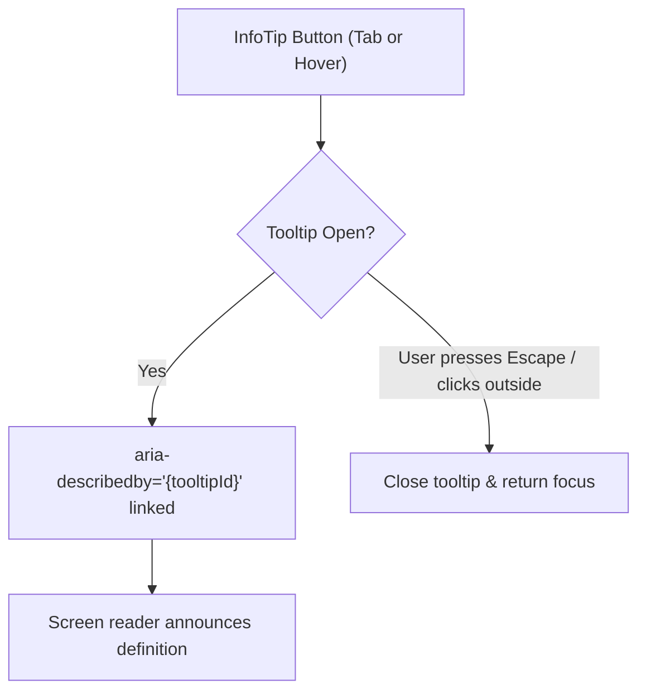

# Accessible Info Tooltip (`InfoTip`) & Key Term Definitions

## Overview

OpenSourceMate presents analytical metrics that benefit from immediate, contextual explanation:
- **"Skill"**: How programming languages and frameworks are detected and quantified.
- **"Public data only"**: Data privacy and scope guarantees (no private code or emails accessed).
- **"Analyzed repositories"**: Exclusion of forks vs source repos, commit recency thresholds.

To provide clear, accessible explanations without cluttering the interface, we implemented the reusable `<InfoTip />` component complying with W3C WAI-ARIA Authoring Practices.

## Technical Architecture & Accessibility

### 1. WAI-ARIA Tooltip Pattern
- **Role Assignment**: Uses `role="tooltip"` for the popover element.
- **Aria DescribedBy**: When open, sets `aria-describedby="{tooltipId}"` on the trigger button so screen readers automatically announce the explanation.
- **State Feedback**: Maintains `aria-expanded={isOpen}` indicating toggle state.
- **Actionable Labeling**: Trigger button has explicit `aria-label="More information about {term}"`.

### 2. Full Keyboard Navigation
- **Focusable**: Trigger button receives standard keyboard focus via Tab.
- **Enter / Space**: Toggles tooltip display.
- **Escape Dismissal**: Pressing the `Escape` key immediately closes the open tooltip and restores focus to the trigger button.
- **Focus Ring**: Prominent `focus-visible:ring-2 focus-visible:ring-emerald-400` ensures clear visual focus indication.

### 3. Touch & Mobile Friendly
- Mouse users can hover to view and leave to dismiss.
- Mobile and touch screen users can tap the trigger icon to toggle the tooltip open and closed.
- Outside-click listeners (`mousedown`) dismiss the tooltip when interacting elsewhere.
- Viewport bounds detection prevents awkward off-screen clipping.

### 4. Key Term Definitions Supported

| Term | In-App Definition | Location |
|------|-------------------|----------|
| **Skill** | Derived from language byte distributions, commit frequencies, and project dependencies across public repositories. | Skill Breakdown & Donut Charts |
| **Public Data Only** | Analyses strictly inspect publicly available GitHub events, repositories, and profile details without accessing private repositories or sensitive tokens. | Header & Analyzer Form |
| **Analyzed Repositories** | Non-fork repositories owned or contributed to by the developer within the configured analysis threshold. | Repository Counts & Comparison View |
| **Match Score** | Relevance percentile derived by cross-referencing repository languages and recent contribution topics with issue issue requirements. | Recommended Issues List |



## Component Usage Example

```tsx
import InfoTip from "@/components/ui/InfoTip";

<div className="flex items-center gap-1.5">
  <span className="font-medium text-slate-200">Skill Distribution</span>
  <InfoTip
    term="Skill"
    content="Derived from language byte distributions and commit frequencies in public repositories."
    position="top"
  />
</div>
```

## Responsive Layout Positions

The tooltip accepts `position="top" | "bottom" | "left" | "right"`:
- `top`: Centered above the trigger element (ideal for cards and table rows).
- `bottom`: Centered beneath trigger (ideal for top navbars and headers).
- `left` / `right`: Horizontal offsets suited for sidebars and tool palettes.

## Testing & Verification

1. **Jest Test Suite**:
   - `npm --prefix frontend test -- __tests__/InfoTip.test.tsx`
   - Validates ARIA attributes, keyboard interaction, Escape key dismissal, outside click behavior, and touch toggle flows.
