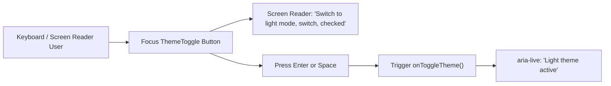

# Accessible Theme Toggle Implementation (WCAG 2.1 AA)

## Overview

The theme switcher is one of the most frequently used controls on OpenSourceMate. To ensure full compliance with WCAG 2.1 AA and Section 508 accessibility guidelines, the theme toggle has been redesigned and extracted into a standardized, reusable `<ThemeToggle />` component.

## Accessibility Features & Specifications

### 1. Semantic Switch Role (`role="switch"`)
- The toggle functions as a binary state control, using `role="switch"` and `aria-checked={isDark}`.
- When dark mode is active: `aria-checked="true"`.
- When light mode is active: `aria-checked="false"`.
- Assistive technologies recognize the component as an actionable toggle switch rather than a generic push button.

### 2. Actionable & State-Aware ARIA Labels
- Clear, unambiguous action labels:
  - In dark mode: `aria-label="Switch to light mode"`.
  - In light mode: `aria-label="Switch to dark mode"`.
- Hidden screen-reader text (`.sr-only`) provides complete situational context: `"Switch to light mode. Currently Dark theme active."`
- Real-time `aria-live="polite"` region ensures immediate audible feedback upon theme transitions without interrupting primary speech.

### 3. Decorative Icon Hiding
- Purely visual SVG icons (sun and moon) are explicitly annotated with `aria-hidden="true"`, preventing screen readers from announcing redundant SVG markup or empty graphics paths.

### 4. Keyboard Navigation & Visible Focus
- Supports standard activation via both `Space` and `Enter` key presses (`onKeyDown`).
- Employs high-contrast focus rings: `focus-visible:ring-2 focus-visible:ring-emerald-400 focus-visible:ring-offset-2` with dark/light offset colors.
- Retains distinct focus styling for keyboard navigation while eliminating disruptive rings for mouse users.

### 5. Color Contrast & Touch Target Compliance
- Minimum 44x44px touch target compliance for mobile and tablet users.
- Light and dark mode button borders and icons exceed WCAG 2.1 AA 3:1 contrast ratios for UI components.
- Seamless component reuse across desktop and mobile navigation menus (`frontend/components/Navbar.tsx`).
- Configurable `showTextLabel` property to render accompanying "Dark" / "Light" labels in settings drawers or storybook.



## Technical Implementation Details

```tsx
// frontend/components/ThemeToggle.tsx
<button
  id={id}
  type="button"
  role="switch"
  aria-checked={isDark}
  aria-label={actionLabel}
  title={actionLabel}
  onClick={onToggleTheme}
  onKeyDown={handleKeyDown}
  className="... focus-visible:ring-2 focus-visible:ring-emerald-400 ..."
>
  <span className="sr-only">{actionLabel}. Currently {currentModeDescription}.</span>
  {isDark ? <SunIcon aria-hidden="true" /> : <MoonIcon aria-hidden="true" />}
</button>
```

## Testing & Verification

1. **Automated Unit & Accessibility Tests**:
   - `npm --prefix frontend test -- __tests__/AccessibleThemeToggle.test.tsx`
   - Validates role assignment, ARIA checked states, label changes, keyboard events (Enter/Space), and SVG `aria-hidden` attributes.
2. **Visual & Screen Reader Inspection**:
   - Tested high-contrast focus rings in both light and dark modes.
   - Screen reader announcement verified via live regions.
