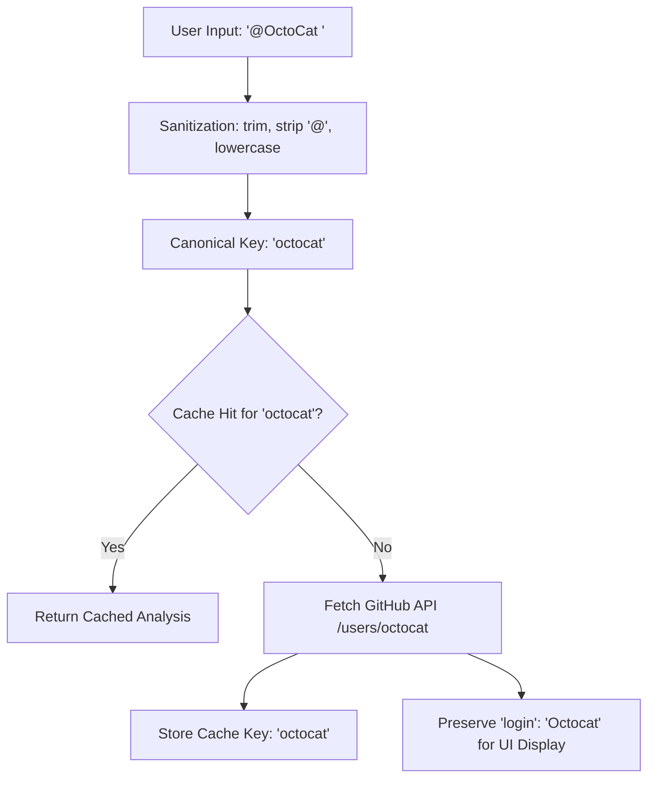

# Canonical GitHub Username Management & Case-Insensitive Standards

## Problem Statement & Context

GitHub usernames exhibit unique behavior:
- **Case-Insensitive Routing & Identity**: GitHub ignores case when resolving usernames in URLs (`github.com/OctoCat` matches `github.com/octocat`), API calls (`api.github.com/users/OCTOCAT`), and git repository URLs.
- **Case-Preserving Display**: GitHub stores and renders the profile login with the user's selected casing (`user.login: "Octocat"`).
- **System Issues Prior to Normalization**:
  1. *Cache Duplication*: Lookups for `octocat`, `Octocat`, and `OCTOCAT` generated three distinct cache keys in Redis / backend memory cache, wasting memory and invalidating TTL synchronization.
  2. *Duplicate Comparison Bugs*: In the `/compare` interface, entering `user1: Torvalds` and `user2: torvalds` bypassed identical-username checks and resulted in duplicate side-by-side renders.
  3. *Inconsistent Query Strings*: Sharing URLs like `/compare?a=LinusTorvalds` vs `/compare?a=linustorvalds` fragmented client analytics and browser history.

## Technical Architecture

### 1. Dual-Tier Representation Pattern
To satisfy both case-insensitive system lookups and human-friendly display, OpenSourceMate implements the Dual-Tier Representation Pattern:

| Tier | Function | Implementation | Usage |
|------|----------|----------------|-------|
| **Storage & Lookup Key** | Canonical Lowercase | `normalize_github_username()` / `sanitizeUsername()` | Backend cache keys, API routes, database lookups, query parameters |
| **Presentation Layer** | GitHub Preserved Login | `formatCanonicalUsername(query, profile.login)` | UI profile titles, avatar labels, export headers |

### 2. Backend Normalization (`backend/app/utils/validation.py`)
- `normalize_github_username(raw_username: str) -> str`:
  - Strips leading and trailing whitespace.
  - Strips leading `@` character if provided by user.
  - Normalizes string to lowercase (`.lower()`).
- `validate_github_username(raw_username: str) -> str`:
  - Rejects invalid characters (hyphens at start/end, double hyphens, non-alphanumeric chars).
  - Returns canonical lowercase string when valid, or raises `InvalidUsernameError`.
- `is_valid_github_username(raw_username: str) -> bool`:
  - Boolean convenience validator adhering to strict GitHub specifications.

### 3. Frontend Utilities (`frontend/utils/validation.ts`)
- `sanitizeUsername(input: string): string`:
  - Normalizes input query strings to lowercase.
- `formatCanonicalUsername(input: string, profileLogin?: string): string`:
  - Returns `profileLogin` if available from GitHub API response.
  - Otherwise returns the normalized lowercase query string.
- `isSameUsername(a: string, b: string): boolean`:
  - Case-insensitive comparison ensuring `Octocat` equals `octocat`.

## Cache Key Determinism & Invalidation Guarantees

All internal caches across the backend services use the canonical key format:
- Profile cache: `user_profile:{canonical_username}`
- Repository cache: `user_repos:{canonical_username}`
- Analysis results: `user_analysis:{canonical_username}`

Because `normalize_github_username` is applied prior to checking or writing to any cache storage:
- Requests for `torvalds`, `Torvalds`, `TORVALDS`, or `@torvalds` consistently map to `user_analysis:torvalds`.
- Rate limiting buckets keyed by username do not allow bypass through case alterations.
- LocalStorage keys on the client remain unified, preventing storage bloat.

## Edge Cases Handled

- **Empty / Whitespace-only Inputs**: Cleanly rejected with descriptive validation feedback.
- **Leading @ Signs**: Transparently stripped across backend routes and client inputs.
- **Boundary Length Constraints**: Validates single character usernames (e.g. `a`) up to 39 character limits.
- **Hyphen Placement**: Strictly forbids leading, trailing, or double hyphens (`--`).
- **Profile Login Retention**: Preserves official casing returned by GitHub profile metadata in frontend display cards.

## Test Plan & Verification

1. **Python / Pytest**:
   - `pytest backend/tests/test_canonical_usernames.py -v`
   - Covers whitespace trimming, `@` stripping, cache key equivalence, character boundaries, hyphen rules, and error handling.
2. **Jest / Frontend**:
   - `npm --prefix frontend test -- __tests__/canonicalUsernames.test.ts`
   - Verifies input normalization, search param determinism, comparison equivalence, and display casing preservation.

## Migration and Compatibility
- All existing caches automatically coalesce into lowercase keys on their next TTL refresh.
- Backward compatible with existing bookmarks and URL links.
