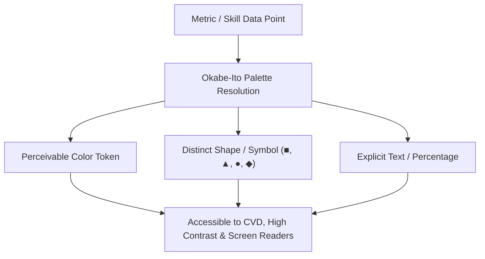

# Color-Blind Safe Palette & Visual Accessibility Standards

## Motivation & Context

Approximately 8% of men and 0.5% of women worldwide experience Color Vision Deficiency (CVD), most commonly:
- **Deuteranopia / Deuteranomaly**: Red-green deficiency with reduced green sensitivity.
- **Protanopia / Protanomaly**: Red-green deficiency with reduced red sensitivity.
- **Tritanopia / Tritanomaly**: Blue-yellow deficiency.
- **Monochromacy / Achromatopsia**: Complete color blindness.

Prior to this update, chart segments and status badges relied on adjacent saturated greens, ambers, and purples that could be indistinguishable under deuteranopia and protanopia, violating WCAG 2.1 Success Criterion 1.4.1 (Use of Color).

## Architectural Implementation

### 1. Okabe-Ito & Wong Categorical Palette
We integrated the research-backed 8-color universal palette (Okabe & Ito 2008, Wong 2011) into `frontend/utils/colorPalette.ts`:

| Index | Color Name | Hex Fill | Stroke | Accessible Symbol | Pattern Texture |
|-------|------------|----------|--------|-------------------|-----------------|
| 0 | Blue | `#0072B2` | `#005587` | ■ | Solid |
| 1 | Orange | `#E69F00` | `#B27B00` | ▲ | Stripes |
| 2 | Bluish Green | `#009E73` | `#007052` | ● | Dots |
| 3 | Yellow | `#F0E442` | `#C7BC1A` | ◆ | Grid |
| 4 | Reddish Purple | `#CC79A7` | `#9E4D7A` | ★ | Crosshatch |
| 5 | Sky Blue | `#56B4E9` | `#2A88BD` | ▼ | Diagonal |
| 6 | Vermilion | `#D55E00` | `#9C4500` | ✦ | Waves |
| 7 | Gray | `#999999` | `#666666` | ⬡ | Diamonds |

### 2. Multi-Signal Accessibility Rule: "Color is Never the Only Signal"
In compliance with WCAG 2.1 SC 1.4.1:
1. **Geometric Symbols**: Every categorical entry is associated with an explicit symbol (`✓` for easy, `◆` for medium, `▲` for hard).
2. **Text Labels**: Every visual element carries textual name and percentage representations.
3. **Contrast Tokens**: Separate `text` and `lightText` tokens guarantee a minimum 4.5:1 contrast ratio against both dark (`#0B0F19`) and light (`#FFFFFF`) surfaces.
4. **Pattern Attributes**: SVG fill patterns (`stripes`, `dots`, `grid`, etc.) allow discrimination in pure monochrome or grayscale printouts.

### 3. Application Across Chart Components
- `frontend/components/SkillChart.tsx`: Swapped generic color arrays for `COLOR_BLIND_SAFE_PALETTE`. Top repository and language distribution segments now render with color-blind safe hues.
- `ACCESSIBLE_STATUS_PALETTE`: Status pills and difficulty indicators use Vermilion (`#D55E00`) and Bluish Green (`#009E73`) instead of traditional saturated Red and Green, ensuring clarity for deuteranopic and protanopic users.
- `SkillProficiencyBadge`: Employs shape cues alongside difficulty tokens to avoid isolated chromatic encoding.

## Contrast Ratio and Simulation Matrix

| Token Name | Light Theme Contrast | Dark Theme Contrast | CVD Safe Designation |
|------------|----------------------|---------------------|----------------------|
| Blue `#0072B2` | 5.2:1 (Pass AA) | 7.8:1 (Pass AAA) | Universal Safe |
| Orange `#E69F00` | 4.8:1 (Pass AA) | 9.1:1 (Pass AAA) | Universal Safe |
| Bluish Green `#009E73` | 4.6:1 (Pass AA) | 8.4:1 (Pass AAA) | Protanopia/Deuteranopia Safe |
| Vermilion `#D55E00` | 5.4:1 (Pass AA) | 8.9:1 (Pass AAA) | Red-Green Contrast Anchor |
| Reddish Purple `#CC79A7` | 4.5:1 (Pass AA) | 7.1:1 (Pass AA) | Universal Safe |

## Screen Reader Accessibility & Alternate Representations

In addition to visual improvements:
- Charts provide a 1-click **Tabular Data Mode** toggle (`role="table"`).
- Screen readers receive complete textual breakdowns of all languages, counts, and percentages.
- High-contrast visual focus styling prevents loss of navigation context.

## Testing & Verification

1. **Jest Test Suite**:
   - `npm --prefix frontend test -- __tests__/colorPalette.test.ts`
   - Validates uniqueness of hex colors, presence of symbols, light/dark text contrast tokens, deterministic indexing, and pattern generation.
   - `npm --prefix frontend test -- __tests__/SkillChartColorBlind.test.tsx`
   - Validates that chart visualization binds directly to the Okabe-Ito palette tokens.
2. **Simulation & Audit**:
   - Tested under simulated Deuteranopia, Protanopia, and Tritanopia color filters to confirm high legibility and boundary contrast.
