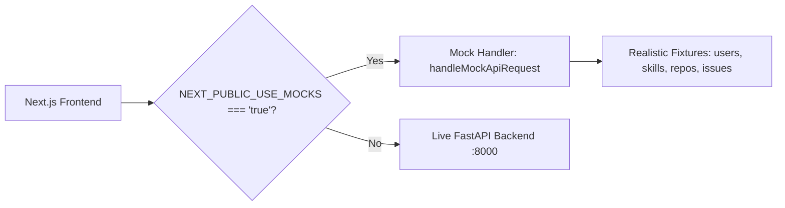

# Mock API & Offline Frontend Development (Issue #136)

## Overview

OpenSourceMate provides a complete mock API layer for offline, backend-less frontend development. With mock API support enabled, developers can run the entire frontend user interface without running the FastAPI Python server or requiring a GitHub personal access token.

## How to Enable Mock API

### Option 1: Browser Environment Variable (`NEXT_PUBLIC_USE_MOCKS=true`)

Create or update `.env.local` inside `frontend/`:

```bash
NEXT_PUBLIC_USE_MOCKS=true
```

Or start the Next.js development server with the environment variable:

```bash
NEXT_PUBLIC_USE_MOCKS=true npm run dev
```

When enabled:

- The typed API client (`frontend/utils/apiClient.ts`) intercepts requests for profile, skills, repository lists, and issue matching automatically.
- No live network requests are made to GitHub or localhost:8000.

### Option 2: Standalone Lightweight Mock Server

You can also run a standalone mock server on port 8000 that mimics the FastAPI backend:

```bash
cd frontend
npm run mock-server
```

This starts a native Node.js HTTP server at `http://127.0.0.1:8000` supporting all frontend endpoints with CORS enabled.

## Supported Mock Fixtures

| Route                                          | Description                                                                                                                                                                                                                                                                               |
| ---------------------------------------------- | ----------------------------------------------------------------------------------------------------------------------------------------------------------------------------------------------------------------------------------------------------------------------------------------- |
| `GET /api/health`                              | Returns health status with `"mode": "mock"`.                                                                                                                                                                                                                                              |
| `GET /api/github/users/:username`              | Returns profile metadata for registered fixtures (`octocat`, `octocat-real`, `tiangolo`, `torvalds`, `gaearon`, `newbie-contributor`, `forks-only-dev`, `alice`) backed by sanitized fixtures in [`fixtures/`](../fixtures/README.md), or dynamically generated valid developer profiles. |
| `GET /api/github/users/:username/skills`       | Returns technical skills breakdown with proficiency levels and percentages (`?include_forks=true` supported).                                                                                                                                                                             |
| `GET /api/github/users/:username/repositories` | Returns repository lists matching backend `RepositoryListSerializer` metadata (`repository_count`, `total_pages_fetched`, `has_more`, `fetched_at`) plus legacy `count`, with optional `?page=` / `?per_page=` pagination.                                                                |
| `GET /api/matching/users/:username/issues`     | Returns matched open-source issues with difficulty and match scores.                                                                                                                                                                                                                      |

### Special Test Usernames for Error Simulation

To simulate edge cases during frontend development, search for these usernames:

- `not-found` or `404`: Simulates a GitHub user 404 response.
- `rate-limited` or `403`: Simulates GitHub rate limiting with `X-RateLimit-Reset`.
- `server-error` or `500`: Simulates internal server error (HTTP 500).

## Architecture


