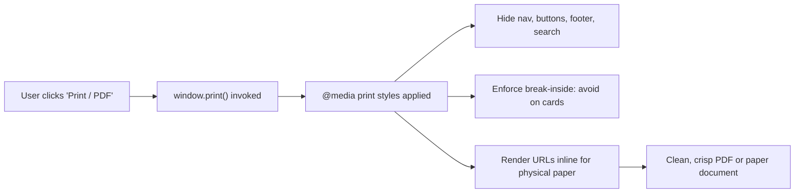

# Print Stylesheet & PDF Export Architecture

## Overview

When developers, recruiters, or hiring managers review GitHub profiles analyzed by OpenSourceMate, they frequently export or print the candidate analysis to PDF or physical paper.

Prior to this update, printing an analysis resulted in illegible dark backgrounds wasting toner, cut-off cards across page breaks, and redundant web chrome (fixed headers, search inputs, navigation buttons, hamburger menus, and footers).

## Features & Implementation

### 1. High-Contrast Print Reset (`frontend/app/globals.css`)
- **Toner-Friendly Ink Saving**: Automatically switches background to pure `#ffffff` and text to deep `#000000`, removing dark gradients and drop shadows.
- **Page Margin & Sizing**: Standardizes output to `size: A4 portrait; margin: 1.5cm;`.
- **Typography Sizing**: Adjusts base body text to `11pt` with clean `1.4` line spacing.

### 2. Elimination of Interactive Chrome
Under `@media print`, non-informative UI controls are hidden:
- Primary sticky navigation bar (`nav`)
- Footer sections (`footer`)
- Interactive buttons and inputs (`button`, `.no-print`, `input`, `select`)
- Modal dialogs and backdrop overlays (`[role="dialog"]`)
- Theme switchers and search bars

### 3. Smart Break Hygiene (`break-inside: avoid`)
- Profile cards, skill donut charts, and checklist sections are styled with `break-inside: avoid` and `page-break-inside: avoid`.
- Headings (`h1`, `h2`, `h3`) utilize `break-after: avoid` to prevent orphan titles sitting at the bottom of printed pages.
- Tables and summary grids prevent breaking across rows.

### 4. Hyperlink Expansion for Hard-Copy
- Printed copies expand external URLs inline:
  ```css
  a[href^="http"]:after {
    content: " (" attr(href) ")";
    font-size: 8pt;
    color: #4b5563;
  }
  ```
- Excludes anchor fragments (`#`) and javascript void handlers.

### 5. `<PrintReportButton />` Component
- Created in `frontend/components/PrintReportButton.tsx`.
- Provides an accessible trigger for `window.print()` with keyboard support, title configuration, and preparation status states.
- Carries `.no-print` class so it vanishes from the generated PDF or printed page.



## Print Media Technical Rules

| Element | Screen Display | Print Media Transformation |
|---------|----------------|----------------------------|
| Body & Canvas | `#05070d` (Dark mode) | Pure `#ffffff` (Zero toner waste) |
| Navigation Header | Fixed sticky top | `display: none !important;` |
| Action Buttons | Interactive UI | `display: none !important;` |
| Content Cards | Transparent glass borders | `1px solid #d1d5db; break-inside: avoid;` |
| Text Color | `#ededed` | Pure `#000000; font-size: 11pt;` |
| Web Links | Underlined hover links | Appended with `(https://...)` URLs |

## Testing & Verification

1. **Jest Unit Tests**:
   - `npm --prefix frontend test -- __tests__/PrintReport.test.tsx`
   - Validates accessible attributes, `window.print` event invocation, timer execution, and `.no-print` class encapsulation.
2. **Print Emulation Audit**:
   - Tested in Chrome/Edge DevTools under `Emulate CSS media type: print` to verify high contrast, no clipping, and page break compliance.
