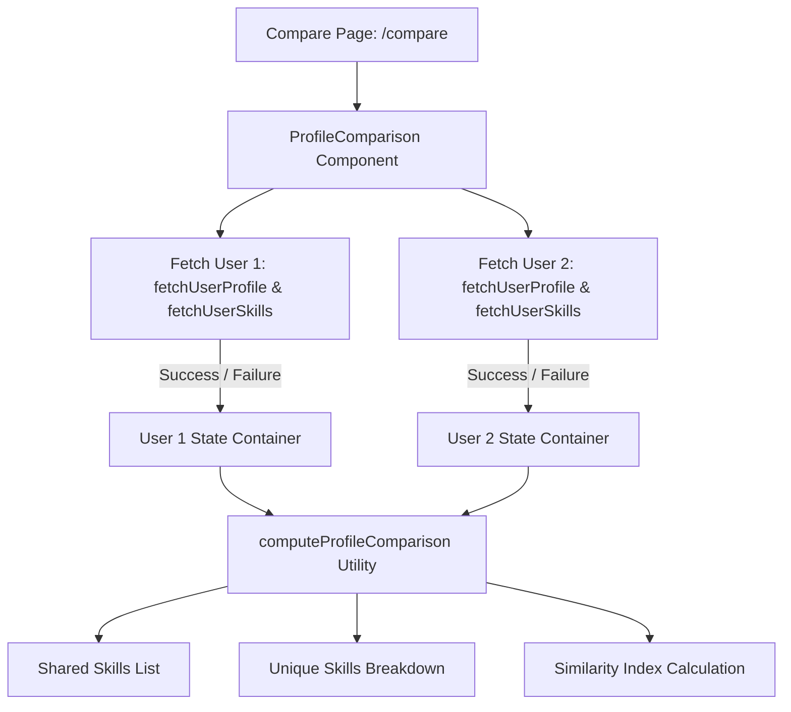

# Profile Comparison Feature Documentation

## Overview

The Profile Comparison feature allows developers, team leads, and open-source maintainers to compare two GitHub profiles side-by-side. It identifies shared technical skills, highlights unique proficiencies, calculates a similarity score based on the Jaccard index, and presents repository distribution metrics.

## Key Features

1. **Side-by-Side Responsive Layout**:
   - **Desktop**: Clean two-column grid (`md:grid-cols-2`) comparing developer metadata, follower counts, and public repositories side-by-side.
   - **Mobile**: Automatically stacks columns vertically for seamless navigation on small viewports.

2. **Fault Isolation (Independent Error Boundaries)**:
   - Queries for Developer 1 and Developer 2 execute concurrently with independent error state handlers (`Promise.allSettled`).
   - If one developer username is invalid (e.g. 404 Not Found, invalid characters), an inline error card with a retry button is displayed specifically in that developer's column.
   - The valid developer's profile and skills analysis are preserved without interruption.

3. **Skill Diffing Engine**:
   - **Shared Skills**: Detects skills detected across both repositories, computes distribution percentages, and renders comparative ratio bars.
   - **Unique Skills**: Isolates skills found exclusively in Developer 1's repositories and Developer 2's repositories.
   - **Comparative Matrix**: A unified overview table of all detected technologies.

4. **Deep Linking & Sharing**:
   - Accessible at `/compare?user1={u1}&user2={u2}`.
   - Updates the URL search parameters in real time using `window.history.replaceState` without full page reloads.

## Architecture

## Acceptance Criteria Verification

- [x] Takes two GitHub usernames and computes shared and unique skills with repository counts.
- [x] Fault isolation: one invalid username does not lose or corrupt the other user's analysis.
- [x] Responsive layout verified for mobile (stacked) and desktop (two columns).
- [x] Unit tests cover normal comparison, isolated errors, tab switching, and swap button.
