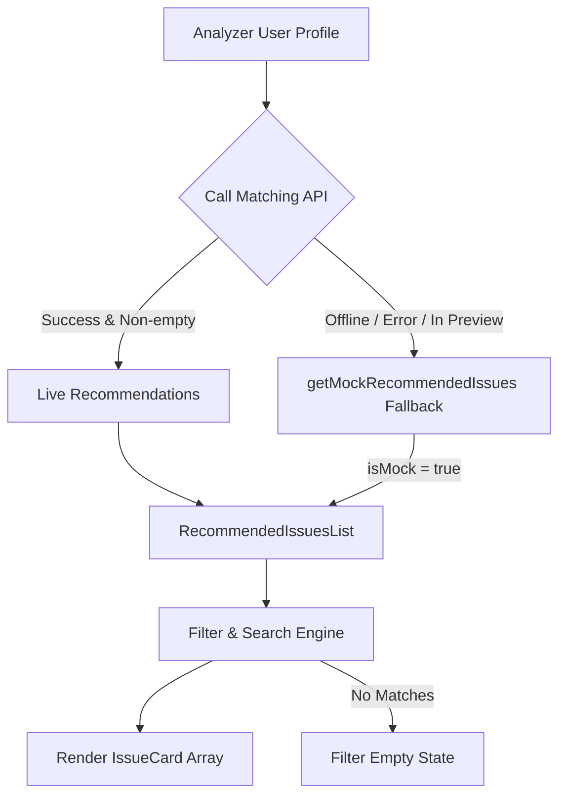

# Recommended Issues UI & Mock Data Feature Documentation

## Overview

The Recommended Issues component displays open-source issue recommendations customized to a developer's identified programming languages and skills. To provide a rich developer experience when the backend matching microservice is unavailable, in preview, or returns an empty result, the frontend includes a resilient fallback to curated, realistic mock data with subtle "Demo data" indicators.

## Key Features

1. **Accessible Issue Cards (`<IssueCard />`)**:
   - **Accessible Headings & Links**: Valid `<h4>` headings with detailed `aria-label` tags (`Open issue "[title]" on GitHub in a new tab`).
   - **Difficulty Badges**: Dynamically categorizes each issue as **Beginner**, **Intermediate**, or **Advanced** based on issue labels (e.g., `good first issue`, `documentation`, `performance`, `architecture`) and explicit metadata.
   - **Match Score & Compatibility Reasons**: Color-coded percentage badge (Green $\ge 80\%$, Blue $\ge 60\%$, Purple otherwise) with breakdown checkmarks of why the issue matches the developer's profile.
   - **Preview / Demo Badge**: Subtle badge (`Demo Data`) visible when rendered in fallback mode.

2. **Resilient Mock Matching (`mockIssues.ts`)**:
   - Realistic dataset spanning TypeScript, Python, React, Go, Rust, and CSS repositories (`vercel/next.js`, `tiangolo/fastapi`, `facebook/react`, `golang/go`, `BurntSushi/ripgrep`, `tailwindlabs/tailwindcss`).
   - Dynamic scoring algorithm (`getMockRecommendedIssues`) that re-ranks issues based on user-detected skill sets.

3. **Multi-dimensional Filtering (`<RecommendedIssuesList />`)**:
   - Filter by Difficulty (All, Beginner, Intermediate, Advanced).
   - Filter by Language.
   - Filter by Label type (Good First Issue, Help Wanted).
   - Filter by minimum match compatibility score.
   - Live search filter by issue title or repository name.
   - Reset filters button.

4. **Empty State Handling**:
   - **Filter Empty State**: Shown when active filters yield zero matches, with a one-click "Reset filters" action.
   - **Overall Empty State**: Friendly fallback when no issues match the skills profile.

## Architecture

## Acceptance Criteria Verification

- [x] Renders cards with title, repository, match score/reasons, difficulty badge, and link to GitHub.
- [x] When backend matching is not ready, shows realistic mock data with a subtle "Coming soon" / "Demo data" indicator.
- [x] Empty state when no issues match.
- [x] Visual design matches rest of the application (dark & light theme support).
- [x] Cards are accessible with proper headings and screen-reader link text.
