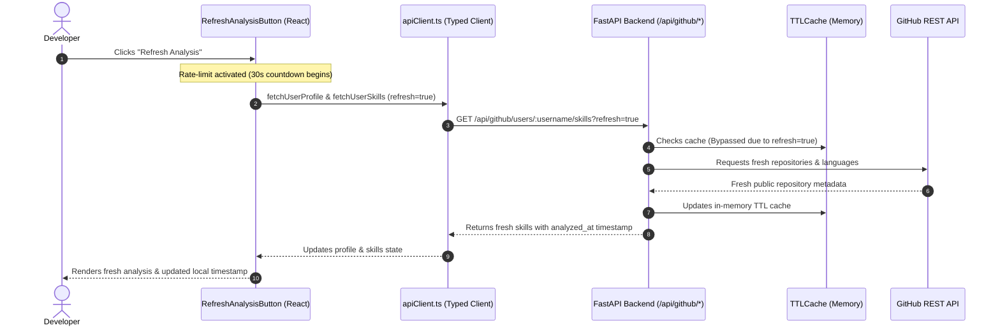

# Refresh Analysis Button and Timestamp Architecture (#132)

## Overview
This feature introduces an intuitive **"Refresh Analysis"** capability with transparent **"Analyzed at"** timestamp presentation, resolving [Issue #132](https://github.com/Muskankr/OpenSourceMate/issues/132). 

Contributors and developers viewing an analyzed GitHub profile can clearly inspect when the analysis was performed (rendered in their local browser time zone) and trigger a fresh re-scan that bypasses the backend's in-memory TTL cache (implemented in #14). To avoid rate limit exhaustion on public GitHub instances, the client enforces a 30-second rate-limit cooldown.

---

## Key Requirements & Acceptance Criteria
- **Local Timezone Formatting**: Analysis generation timestamps (`analyzed_at`, `fetched_at`) are captured in ISO 8601 UTC and rendered on the client according to the user's localized time zone via standard `Intl.DateTimeFormat`.
- **Cache Invalidation & Bypass**: The refresh action sends `refresh=true` to backend endpoints, bypassing the cached in-memory response, querying GitHub API directly, and updating the cache with the fresh dataset.
- **Client-Side Rate-Limiting**: The refresh trigger is rate-limited on the client with a 30-second cooldown timer to safeguard against rapid repeated clicks and unintentional quota drain.
- **Accessibility & Feedback**: Screen-reader friendly with `aria-live="polite"`, `aria-label`, and interactive countdown indicators.

---

## Architecture & Implementation Details

### 1. Backend Route & Cache Extensions
- **Route Parameters**: Added optional query parameter `refresh: bool = Query(default=False)` to:
  - `GET /api/github/users/{username}`
  - `GET /api/github/users/{username}/repositories`
  - `GET /api/github/users/{username}/skills`
- **Cache Bypass**: In `app.services.github_service`:
  - `get_github_user(username, refresh=False)`: Skips `cache.get()` when `refresh=True`.
  - `get_user_repositories(username, ..., refresh=False)`: Traverses GitHub pagination directly and updates cache.
  - `get_repository_details(repositories, ..., refresh=False)`: Propagates cache refresh flag to manifest and language inspection.
- **Timestamp Emission**: Each endpoint outputs `analyzed_at` or `fetched_at` containing the exact ISO 8601 UTC timestamp (`datetime.now(timezone.utc).isoformat()`).

### 2. Frontend Component & Local Timezone Conversion
- **Component**: `frontend/components/RefreshAnalysisButton.tsx`
  - Uses `Intl.DateTimeFormat(undefined, { month: 'short', day: 'numeric', hour: 'numeric', minute: '2-digit', second: '2-digit', hour12: true })` to dynamically map the UTC timestamp to the user's localized browser locale and time zone.
  - Controls countdown state `secondsRemaining` via `setInterval` tick decrementing every 1000ms.
  - Disables button interaction during cooldown (`aria-disabled="true"`).

---

## Verification
- **Backend Tests**: 149/149 tests passing (`pytest backend/tests/`).
  - Unit tests in `backend/tests/test_refresh_cache.py` verifying cache bypass and timestamp presence.
- **Frontend Tests**: Full test suite passing with RTL test coverage in `frontend/__tests__/RefreshAnalysisButton.test.tsx`.
- **TypeScript & Linting**: `npx tsc --noEmit` and `npm run lint` clean with 0 warnings.
