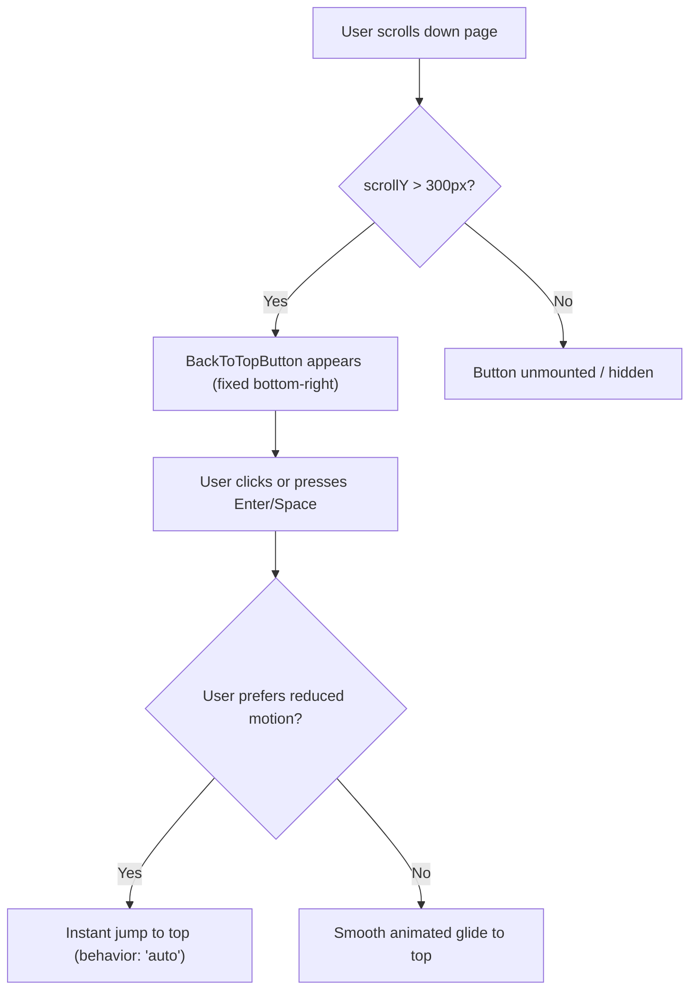

# Sticky-Navbar Scroll Offsets & Accessible Back-To-Top Button

## Problem Statement & Context

When navigating long analysis pages or reading the landing documentation:
1. **Header Occlusion**: Clicking anchor links (such as `#how-it-works`, `#analyzer`, or `#faq`) jumped the window to the exact element coordinate, causing the top portion of the section headings to be obscured beneath the fixed sticky navigation bar.
2. **Scroll Fatigue**: Once deeply engaged down a multi-page analysis or long list of recommended issues, users had no quick, accessible mechanism to return to the primary controls without manual scrolling.

## Technical Solutions Implemented

### 1. Global Anchor Scroll Margin Offsets (`frontend/app/globals.css`)
We introduced global scroll-margin rules tailored to the height of the fixed navigation header (`h-16` / `4rem` + safe padding):
```css
[id],
section[id],
article[id] {
  scroll-margin-top: 5.5rem;
}
```
This guarantees that any link or programmatic scroll targeting an anchor ID leaves comfortable visual headroom below the sticky navbar across desktop, tablet, and mobile displays.

### 2. Accessible `<BackToTopButton />` Component (`frontend/components/BackToTopButton.tsx`)
- **Threshold Detection**: Automatically appears when `window.scrollY > 300px`, remaining invisible while near the top of the viewport.
- **Prefers-Reduced-Motion Compliance**:
  - Automatically queries `window.matchMedia("(prefers-reduced-motion: reduce)")`.
  - If reduced motion is requested, scrolls instantly (`behavior: "auto"`).
  - Otherwise delivers fluid smooth scrolling (`behavior: "smooth"`).
- **WAI-ARIA & Keyboard Accessibility**:
  - Tab accessible with high-contrast visible focus ring (`focus-visible:ring-2 focus-visible:ring-emerald-400`).
  - Supports both `Enter` and `Space` keyboard activations.
  - SVG upward chevron is annotated with `aria-hidden="true"`.
  - Accessible name specified via `aria-label="Scroll back to top of page"` and matching `title`.
  - Layered on high z-index (`z-40`) to remain above content cards while respecting modal backdrops.



## Behavioral Specifications

| Property / Feature | Default | Configuration / Behavior |
|--------------------|---------|--------------------------|
| `threshold` | `300` px | Minimum vertical scroll offset in pixels before rendering |
| Motion preference | Dynamic | Detects OS preference; switches smoothly between `smooth` and `auto` |
| Screen position | `bottom-6 right-6` | Fixed floating action button position |
| Keyboard keys | Space, Enter | Native keyboard event triggers |
| Assistive technology | Verbose label | "Scroll back to top of page" announced |

## Testing & Verification

1. **Jest Test Suite**:
   - `npm --prefix frontend test -- __tests__/BackToTopButton.test.tsx`
   - Validates threshold visibility toggling, reduced-motion media query handling, keyboard activation, and SVG `aria-hidden` attributes.
2. **Interactive Verification**:
   - Verified that clicking `#faq` and `#how-it-works` in the desktop and mobile navigation menus places headings cleanly below the sticky navbar without any occlusion.
