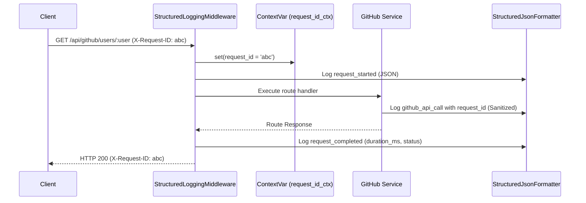

# Structured Logging and Request IDs (Issue #137)

## Overview

Structured logging and request ID tracking provides observability, correlation across distributed operations, and audit trails while safeguarding sensitive credentials from log leakage.

## Key Capabilities

1. **Request ID Lifecycle & Context Propagation (`X-Request-ID`)**:
   - Every request is tagged with an `X-Request-ID`.
   - If provided by client, the ID is preserved. Otherwise, a UUID4 is generated.
   - Propagated to downstream logging handlers using Python's `contextvars.ContextVar` across async tasks.
   - Attached to outgoing HTTP response headers for end-to-end client-server tracing.

2. **Structured JSON Log Formatter (`StructuredJsonFormatter`)**:
   - Emits standardized JSON lines with ISO 8601 UTC timestamp, log level, logger name, module/line number, message, and contextual `request_id`.
   - Supports extra dictionary payloads through `extra={"structured_data": {...}}`.

3. **Data Sanitization & Token Masking (`sanitize_sensitive_data`)**:
   - Recursively scrubs fields with names matching sensitive patterns (`token`, `authorization`, `password`, `secret`, `api_key`).
   - Automatically masks GitHub PAT and Bearer token regex patterns in strings.

## Architecture

